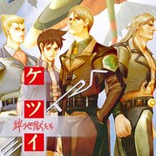

<div align=center>



</div>
<h1 align=center>ketsui-nx installer</h1>

The installer page of [ketsui-nx](https://github.com/ChanseyIsTheBest/ketsui-nx), the native Nintendo Switch port of
Ketsui: Kizuna Jigoku Tachi (Xbox 360, Ketsui Kizuna Jigoku Tachi Extra): **https://chanseyisthebest.github.io/ketsui-nx-installer/**

You give it your own copy of the game (the disc image, or a folder you extracted it into), and it gives you a zip ready
to extract into `sdmc:/switch/`. Everything runs in your browser: the game files never leave your computer.

## What it does

1. Finds the game in what you chose: a disc image (`.iso`: a full dump, read in place through its XDVDFS game
   partition, or an image rebuilt by extract-xiso; nothing is extracted to disk), or a folder with `default.xex`.
2. Identifies the game by the SHA-256 of `default.xex` (the Japanese disc, title `465607D1`) and the sizes of its other
   files, and picks its build from `release/manifest.json`.
3. Downloads that build's NRO and checks its SHA-256.
4. Makes the shaders of the deko3d renderer: the NRO holds only the 12 shaders no game file holds (Ketsui compiles them
   at run time from HLSL text) and reads `deko3d_glsl.bin` beside itself for the rest. Ketsui stores 88 Direct3D
   shader containers in `default.xex`'s data (`lib/containers.js`). Each goes through ketsui-nx's native chain
   (`tools/renut_deko3d_shaders.sh`, guwange-nx's), in the page: Renut's XenosRecomp translates it to HLSL
   (`wasm/renut_hlsl`), the alpha-tested pixel shaders get their early alpha copy (`lib/early_alpha.js`), DXC compiles it
   to SPIR-V (`wasm/dxc_web`), SPIRV-Cross turns that into GLSL (`wasm/spirv_cross`), banjo-nx's and guwange-nx's
   passes trim it (`lib/deko3d_glsl.js`) and `lib/deko3d_package.js` packs them. All 88 shaders' GLSL is the native
   chain's (24 byte for byte; in the other 64 the page's newer DXC numbers its temporaries differently), and the package
   must match the tested one (its SHA-256 is in `release/manifest.json`). The console compiles each shader with uam the
   first time the game uses it and keeps the result.
5. Streams the zip to disk through the service worker, so a whole disc never has to fit in memory.

The zip holds `ketsui-nx/ketsui.nro` with its `LICENSES.txt`, `deko3d_glsl.bin` and the game in `game_root/` (as on
the disc, without the console's system update). The update zip holds the NRO, its licenses and the shaders. Neither
holds `ketsui.toml`: the game writes it at its first start, so an update never overwrites your settings.

The page and the downloaded program are cached by the service worker: after the first visit it also works without a
connection.

## Layout

| Path | Contents |
|---|---|
| `index.html`, `app.js` | The page and its interface (English and Japanese, `lib/i18n.js`) |
| `worker.js` | Builds the package off the main thread |
| `sw.js` | Offline cache and the download stream |
| `lib/` | Disc image reader (XDVDFS), XEX reader, shader containers, deko3d shader chain, zip writer |
| `wasm/` | WebAssembly builds: DXC and the LZX decoder (futari-nx-installer's), Renut's shader translator and SPIRV-Cross (`wasm/src/deko3d/build_wasm_deko3d.sh`; the same translator sources as futari-nx's, guwange-nx's and ketsui-nx's) |
| `release/` | The list of builds and the licenses of the NRO; the deployment adds the NRO from the ketsui-nx release |
| `test/` | Node scripts and a browser page that run the same code as the page |

## Publishing a build

The NRO is not stored here: it is the `ketsui.nro` asset of a release of the ketsui-nx repository of the same owner (a
build with `-ReleaseShaders on`). The workflow in `.github/workflows/deploy.yml` downloads it from the latest release,
checks its SHA-256 against the list and publishes the page on GitHub Pages. It runs on every push to `main`; after
publishing a new release, run it by hand from the Actions tab. Pages must be set to deploy from GitHub Actions
(Settings > Pages > Source).

To publish a new build, put its NRO in `release/` and write the build's entry of `release/manifest.json` from your own
copy with the page's code (it also leaves the page's `deko3d_glsl.bin` in `release/`, not committed: test the NRO with
exactly that file next to it):

```sh
node test/manifest_node.mjs <disc image or game folder> --version 1.0.0 --write
```

## Testing locally

Put `ketsui.nro` in `release/` and serve the folder (any static server works; this one sets the right MIME types):

```sh
python serve.py 8193
```

Then open http://127.0.0.1:8193/. The same code runs in Node:

```sh
node test/package_node.mjs ketsui-nx.zip <disc image or game folder>
node test/package_node.mjs ketsui-nx-update.zip <disc image or game folder> --update
node test/deko3d_node.mjs <disc image or game folder> --native <ketsui-nx's out/deko3d_shaders/glsl_opt>
node test/texts_node.mjs
```

## License

GPL-3.0 (see [LICENSE](LICENSE)). Third-party components are listed in [NOTICES.md](NOTICES.md). The page is built on
[guwange-nx-installer](https://github.com/ChanseyIsTheBest/guwange-nx-installer) and
[futari-nx-installer](https://github.com/ChanseyIsTheBest/futari-nx-installer), themselves built on
[peggle1-nx-installer](https://github.com/ChanseyIsTheBest/peggle1-nx-installer),
[peggle2-nx-installer](https://github.com/ChanseyIsTheBest/peggle2-nx-installer),
[sa2-nx-installer](https://github.com/ChanseyIsTheBest/sa2-nx-installer) and
[nfsmw-nx-installer](https://github.com/StevensND/nfsmw-nx-installer) by StevensND. Renut's renderer is reNut's, by
reNut and masterspike52.

Ketsui: Kizuna Jigoku Tachi is a game by CAVE; its Xbox 360 edition was published by 5pb. This project is not
affiliated with or endorsed by CAVE, 5pb., Nintendo or Microsoft.
